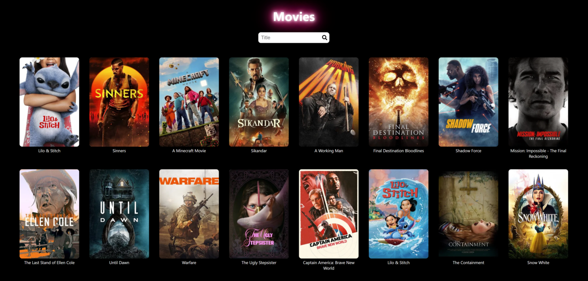

# Movie Explorer

A responsive React application for discovering trending movies and searching The Movie Database in real time.

**[Open the live application](https://movies-yeinier.netlify.app/)**



## Features

- Real-time movie search with instant suggestions
- Debounced input to reduce unnecessary API calls
- Infinite scrolling for trending content
- Detailed movie views with synopsis, rating, and release date
- Responsive grid layout

## Technology

- React
- React Router
- Fetch API
- TMDb API
- CSS Modules

## Demo


## Local setup

```bash
git clone https://github.com/Yeinier22/movie-explorer.git
cd movie-explorer
npm install
```

Copy the environment template:

```bash
cp .env.template .env
```

Add your TMDb credentials:

```env
REACT_APP_API=https://api.themoviedb.org/3
REACT_APP_API_TOKEN=your_tmdb_api_token
```

Start the development server:

```bash
npm start
```

## License

MIT
